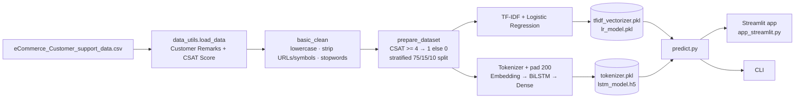

# 🧠 DeepCSAT — E-commerce Customer Satisfaction Prediction

> Predict whether an e-commerce customer is **satisfied** or **not satisfied** from the free-text remarks they leave after a customer-support interaction, using a TF-IDF + Logistic Regression baseline and a Bidirectional LSTM.


**Live demo (Streamlit Community Cloud):** https://darksun003-deepcsat-ecommerce-customer--srcapp-streamlit-kms3ad.streamlit.app/

---

## ✨ Features

- **Text-based CSAT classification**: turns the 1–5 `CSAT Score` into a binary target (`>= 4` → satisfied, otherwise not satisfied) and predicts it from `Customer Remarks`.
- **Two models, one interface**
  - **Baseline**: TF-IDF vectorizer + Logistic Regression (`models/tfidf_vectorizer.pkl`, `models/lr_model.pkl`)
  - **Deep**: Embedding → Bidirectional LSTM (128) → Dense layers with dropout (`models/lstm_model.h5`, `models/tokenizer.pkl`)
- **Text cleaning pipeline**: lower-casing, URL removal, non-alphanumeric stripping, NLTK English stopword removal.
- **Stratified train / validation / test split** (75 / 15 / 10) with a fixed random seed.
- **Training safeguards**: `ModelCheckpoint` on best `val_accuracy` and `EarlyStopping` (patience 4).
- **Streamlit web app**: paste a customer message, pick a model, get a Satisfied / Not Satisfied verdict.
- **CLI prediction** via `src/predict.py`.
- **One-click dev environment**: `.devcontainer` config for GitHub Codespaces that installs requirements and starts the app on port 8501.

## 🛠 Tech Stack

| Layer | Tools |
|---|---|
| Language | Python 3.11 (dev container image) |
| Data | pandas, NumPy |
| NLP preprocessing | NLTK (stopwords), regex |
| Classical ML | scikit-learn (TF-IDF, Logistic Regression, `train_test_split`), joblib |
| Deep learning | TensorFlow / Keras (Embedding, Bidirectional LSTM) |
| App | Streamlit |
| Environment | Dev Containers / GitHub Codespaces |

## 🏗 Architecture



## 📂 Project Structure

```
DeepCSAT-Ecommerce-Customer-Satisfaction-Score-Prediction/
├── .devcontainer/
│   └── devcontainer.json          # Codespaces / Dev Container setup (runs Streamlit on 8501)
├── data/
│   └── eCommerce_Customer_support_data.csv   # Support-interaction dataset (85,907 rows)
├── models/
│   ├── lr_model.pkl               # Logistic Regression baseline
│   ├── tfidf_vectorizer.pkl       # TF-IDF vectorizer for the baseline
│   ├── lstm_model.h5              # Bi-LSTM model
│   └── tokenizer.pkl              # Keras tokenizer for the Bi-LSTM
├── src/
│   ├── data_utils.py              # Loading, cleaning, label binarisation, splits
│   ├── train_baseline.py          # Baseline training entry point (see note below)
│   ├── train_lstm.py              # Bi-LSTM training
│   ├── predict.py                 # predict_baseline / predict_lstm + CLI
│   └── app_streamlit.py           # Streamlit UI
├── DeepCSAT – Ecommerce.pptx      # Project brief / dataset overview slides
├── requirements.txt
└── README.md
```

## 📊 Dataset

`data/eCommerce_Customer_support_data.csv` covers one month of customer-support interactions on an e-commerce platform ("Shopzilla"). It has 20 columns, including channel, category, sub-category, `Customer Remarks`, order and response timestamps, agent / supervisor / manager, tenure bucket, shift and `CSAT Score` (1–5).

- 85,907 rows in total; 28,756 of them have non-empty `Customer Remarks` (rows without remarks are dropped before training).
- The CSAT distribution is skewed towards 5, so roughly three quarters of the usable rows fall in the "satisfied" class.

## 🚀 Getting Started

### Option A: GitHub Codespaces
Open the repo in a Codespace. The dev container installs `requirements.txt` and launches the Streamlit app on port 8501 automatically.

### Option B: Local setup

```bash
git clone https://github.com/Gonugunta-Venkata-Jayanth/DeepCSAT-Ecommerce-Customer-Satisfaction-Score-Prediction.git
cd DeepCSAT-Ecommerce-Customer-Satisfaction-Score-Prediction

python -m venv venv
source venv/bin/activate        # Windows: venv\Scripts\activate
pip install -r requirements.txt
```

> Run every command from the **repository root**: the scripts read `data/` and `models/` with relative paths.

### Run the app

```bash
streamlit run src/app_streamlit.py
```

### Predict from the command line

```bash
python src/predict.py --text "The refund still hasn't arrived after two weeks" --model baseline
python src/predict.py --text "Agent resolved my issue quickly, thanks!" --model lstm
```

The output is `[1]` (satisfied) or `[0]` (not satisfied).

### Retrain the models

```bash
python src/train_lstm.py        # trains the Bi-LSTM, saves models/lstm_model.h5 + models/tokenizer.pkl
```

> **Note:** `src/train_baseline.py` currently contains the same Bi-LSTM training code as `train_lstm.py`. The TF-IDF + Logistic Regression artifacts used by the app (`models/tfidf_vectorizer.pkl`, `models/lr_model.pkl`) are shipped pre-trained in `models/`.

The training script prints the test-set accuracy at the end of each run.

## 🔮 Future Work

- Restore a dedicated TF-IDF + Logistic Regression training script in `train_baseline.py`.
- Record evaluation results (accuracy, precision/recall/F1, confusion matrix) for both models in the repo.
- Use the structured columns (channel, category, handling time, agent tenure, shift) alongside the text, as the project brief's ANN objective describes.
- Handle class imbalance (class weights or resampling) and predict the full 1–5 score, not just a binary label.
- Cache loaded models in the Streamlit app (`st.cache_resource`) so they aren't reloaded on every prediction.
- Move the large model files to Git LFS or a release asset.

## 👤 Author

**Jayanth Gonugunta Venkata**: [github.com/Gonugunta-Venkata-Jayanth](https://github.com/Gonugunta-Venkata-Jayanth)
